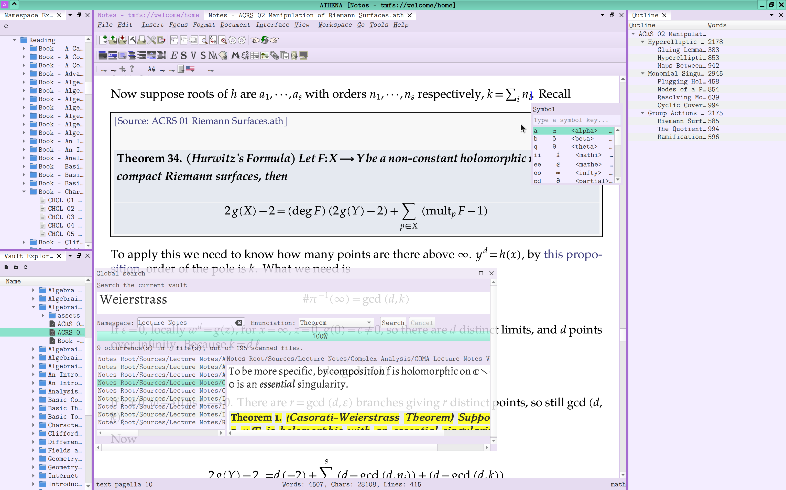

# ATHENA

<p align="center">
  
</p>

**Advanced Typesetting and Hypertext Environment for Notes and Archives**

ATHENA is a mathematics-centered knowledge-work environment derived from GNU
TeXmacs. It keeps structured WYSIWYG mathematical editing and high-quality
typesetting while developing its own document, vault, search, linking, and
knowledge-management model.



ATHENA is not a conservative TeXmacs distribution and is not intended to be a
drop-in replacement for upstream TeXmacs. The primary ATHENA document format is
`.ath`, the executable is `ATHENA.bin`, and the user configuration directory is
`~/.ATHENA`.

## Scope

ATHENA is designed for large structured mathematical note collections. Its main
workflows center on vaults, wikilinks and transclusions, Materials and citations,
namespaces, structural search, mathematical editing, and native Qt tools. The
application also uses per-buffer execution actors so mutable editor, document,
typesetting, and buffer-bound Scheme state remain owned by the corresponding
buffer.

Many inherited TeXmacs subsystems that do not fit this direction have been
removed rather than kept for compatibility. ATHENA therefore favors its own
maintained workflows over preserving the full historical TeXmacs feature set.

## Compatibility with GNU TeXmacs

Compatibility is not guaranteed in either direction.

Upstream TeXmacs is not expected to understand ATHENA-specific document nodes,
vault semantics, or other ATHENA extensions. Conversely, ATHENA does **not**
guarantee that it can open an upstream TeXmacs document correctly. Support for
many older TeXmacs features and subsystems has been removed, so upstream
documents that depend on those features may fail to load correctly, lose
unsupported structure, or behave differently in ATHENA.

Treat `.ath` as the native ATHENA format. If interchange with another system is
required, use an explicitly supported export format and verify the result.

## New in 0.11

ATHENA 0.11 introduces a **native XML v3 document model** and expands the
mathematical editing, layout, knowledge-management and synchronization runtime.

- **Native XML v3 documents.** Canonical `.ath` storage preserves node UUIDs,
  typed properties and strict Unicode text, with explicit native math nodes for
  delimiters, scripts, big operators, grids and display formulas. Native math
  is edited and typeset as structured trees, not rewritten as legacy TeXmacs
  wrappers. Files written in XML v3 are not expected to open in older ATHENA.
- **Mathematical editing and interchange.** The native math editor handles
  paired delimiters, scripts and primes, formula selection and focus, equation
  grids and row insertion/deletion. Native TeX, MathML and HTML/MathJax paths
  use explicit representation boundaries and reject unsupported lossless
  conversions instead of silently discarding structure.
- **Vault history and distributed replication.** Document histories, source
  identities, Artifacts and structured indexes accompany the XML v3 upgrade.
  Hodarium speaks a v3 document revision format with a new wire boundary;
  an older client must not write old revisions into a v3 Vault. The Linux
  desktop and the headless NAS node are used together with the v3 protocol.
- **Native workspaces and services.** BufferActor ownership, Qt commands and
  panes, source-owned wikilinks/transclusions, Materials, namespace Luau
  sorters, structured search, native PDF output, backups, plugins/AUDMAP and
  optional NPU workloads continue evolving from the 0.10 foundation.

See [the XML v3 contract](notes/athena-xml-v3.md) for the current source model.
The earlier 0.10 release introduced UTF-8 text, source UUIDs and the first
XML metadata model; those are historical milestones, not the current storage
format.

### Existing Vaults and compatibility

**Do not run an upgrade on an active Vault.** A Vault already using
`node_model_version=2` and XML v3 needs no further format migration.
For an older Vault, close all editors and Hodarium writers, preserve an
independent backup, and assess a separate copy first. The available **offline**
v2-to-v3 command is:

```sh
ATHENA/bin/ATHENA.bin --upgrade-vault-xml-v3 --check /path/to/copy
```

The explicit `--publish` mode replaces a Vault after preflight and staged
validation; it is **not** an on-open conversion or a command to run casually
on production data. Earlier legacy Cork/S-expression and node-model upgrades
are separate transitions and may be required before a v2-to-v3 conversion.
Do not delete the Vault's history or Artifact databases as an upgrade method.
A v3 Vault requires v3-capable Hodarium peers, including any headless replicas;
there is no mixed-format replication. For a migration, inspect diagnostics
and verify actual documents and histories before switching devices.

## Building ATHENA

The maintained full compilation guide is the ATHENA document
**ATHENA - Compiling** (the PDF is exported separately from ATHENA).
The repository's `COMPILE.ath`, `COMPILE.tex` and `COMPILE.pdf` are older
0.10-era snapshots and are not the authoritative 0.11 build guide.

**GNU/Linux x86-64:** Qt 6 with native Wayland is the maintained desktop
target. An existing configured Debug tree is built with:

```sh
cmake --build build_qt6 --target ATHENA.bin -j20
```

Do not substitute the default ALL target, which also operates on staged
runtime resources and Scheme bytecode. A new configuration needs the
project's CMake dependencies, private Guile 3 runtime, FreeType, HarfBuzz,
ICU and LMDB. Intel oneAPI `icx`/`icpx` is the primary Linux toolchain.
Optional NPU RAG requires a working OpenVINO/Intel NPU environment and
separate compatible models; weights are not included in source releases.

**iPadOS:** ATHENA has an arm64 iPad application build path using an Xcode
macOS host, Qt for iOS, precompiled no-JIT private Guile and the
`tools/ipados/` scripts. The intended device baseline is iPadOS 27 or later
on M2-or-newer iPads; the iPad application target is `ATHENA`, not
`ATHENA.bin`. After provisioning the target dependencies, the host
workflow uses:

```sh
tools/ipados/sync-source-to-vm.sh
tools/ipados/configure-athena.sh
tools/ipados/build-athena.sh
```

The iPad application bundle is distinct from a signed, installable IPA;
device signing and provisioning are separate. Review
`tools/ipados/` and `cmake/README-iPadOS.md` for target inputs and
capabilities. Windows and macOS desktop remain outside the maintained
Linux/iPadOS application build paths.

## Documentation

After starting ATHENA, use the documentation under the Help menu. The manual is
still under construction. Additional project information is available at
[athena.evalisk.org](https://athena.evalisk.org/).

The welcome and getting-started pages describe 0.11. Much of the inherited
reference manual still uses legacy help markup and may describe retired
features; a wider documentation rewrite is planned for 1.0. This retained help
format is not the native format for newly saved user documents.

## Status

ATHENA 0.11 is under active development. Interfaces, document structures, and
workflows may still change as the project develops.

## Licensing

ATHENA is free software under the GNU General Public License, version 3 or
later. See [LICENSE](./LICENSE), [COPYING](./COPYING), and
[ATHENA/COPYING](./ATHENA/COPYING).

Copyright (C) 1998-2026 Joris van der Hoeven and others.

Copyright (C) 2026 Nuaptan Felix Evalisk.
